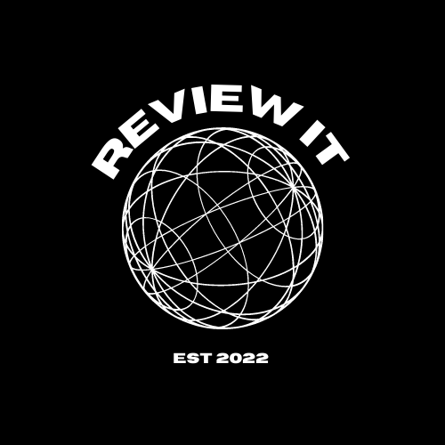
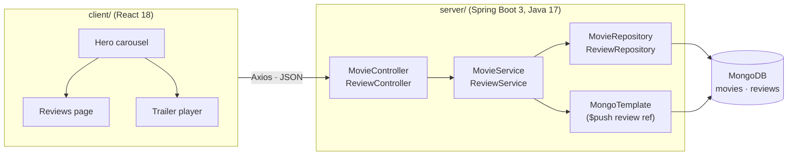

<div align="center">
  
  <h1>Movie Reviewer</h1>
  <p>A full-stack movie app: browse films, watch trailers and post reviews.<br>React front end · Java Spring Boot REST API · MongoDB</p>
</div>

## Overview

Movie Reviewer is an IMDb-style web app. The React client shows a carousel of movies with their artwork. Each movie links to its YouTube trailer and a reviews page where visitors can read and add reviews. The Spring Boot API serves the movie catalogue and saves new reviews to MongoDB.

**What it demonstrates**

- A layered Spring Boot API: **controller → service → repository**, with constructor injection and no framework magic in the domain classes
- **Spring Data MongoDB:** derived queries (`findMovieByImdbId`), `@DocumentReference` relationships, and an atomic `$push` through `MongoTemplate`
- Consistent JSON errors from a `@RestControllerAdvice` (`400` for invalid input, `404` for unknown movies, `201` on create)
- Configuration through environment variables, with no credentials in the code
- A React 18 client using React Router, Axios, React Bootstrap, MUI and React Player

## Architecture



When a review is posted, it's saved in the `reviews` collection, and its id is pushed onto the movie's `reviews` array. Because the movie stores references rather than copies, movie documents stay small however many reviews they collect.

## API

| Method | Route | Description |
| --- | --- | --- |
| GET | `/api/v1/movies` | All movies |
| GET | `/api/v1/movies/{imdbId}` | One movie with its reviews (`404` if not found) |
| POST | `/api/v1/reviews` | Body `{"reviewBody": "...", "imdbId": "tt..."}` → `201` with the saved review |

## Getting started

**Prerequisites:** Java 17+, Node.js 18+, and a MongoDB connection string (a free MongoDB Atlas cluster works).

```sh
git clone https://github.com/CarltonOsinde/Movie-Reviewer.git
cd Movie-Reviewer

# 1. API  →  http://localhost:8080
cd server
cp .env.example .env          # add your MONGO_URI
./mvnw spring-boot:run

# 2. Client  →  http://localhost:3000   (new terminal)
cd ../client
cp .env.example .env          # REACT_APP_API_URL=http://localhost:8080
npm install
npm start
```

Run the API tests with `./mvnw test`.

### Data

Movies are read from the `movies` collection. Each document looks like this (the URLs are placeholders):

```json
{
  "imdbId": "tt0000001",
  "title": "Example Movie",
  "releaseDate": "2022-01-01",
  "trailerLink": "https://www.youtube.com/watch?v=XXXXXXXXXXX",
  "poster": "https://example.com/poster.jpg",
  "genres": ["Drama"],
  "backdrops": ["https://example.com/backdrop.jpg"],
  "reviews": []
}
```

## Project structure

```
server/src/main/java/com/example/moviereviewer/
  controller/   REST endpoints
  service/      business rules (validation, linking reviews to movies)
  repository/   Spring Data MongoDB repositories
  model/        Movie and Review documents
  dto/          request bodies
  exception/    not-found exception + global error handler
  config/       CORS configuration
client/src/
  api/          Axios instance (base URL from REACT_APP_API_URL)
  components/   hero carousel, trailer, reviews, review form, header
```

## Contact

Carlton Osinde Makini · [LinkedIn](https://www.linkedin.com/in/carltonosinde/) · [carltonosinde.com](https://carltonosinde.com) · [Email](mailto:carltonosinde@gmail.com)
